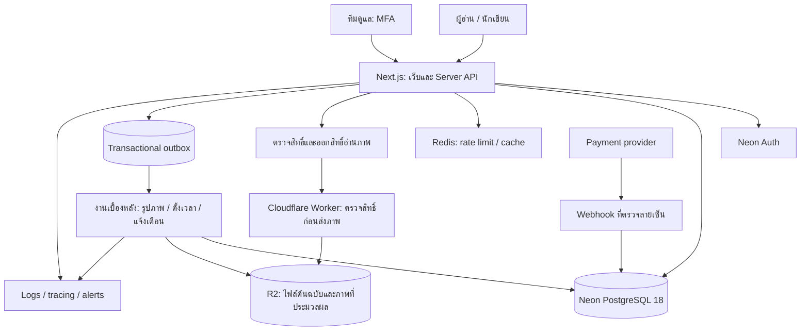
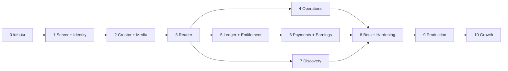

# MyMunga — แผนพัฒนาจนเปิดใช้งานจริง

จัดทำวันที่ 15 พฤศจิกายน 2026 · สถานะ: แผนสำหรับพัฒนาต่อ ไม่ใช่รายการความสามารถที่ทำเสร็จแล้ว

## 1. เป้าหมายและสมมติฐาน

MyMunga เป็นแพลตฟอร์มภาษาไทยสำหรับอ่านและเผยแพร่การ์ตูนกับนิยาย รองรับผู้อ่าน นักสร้างสรรค์ ทีมตรวจเนื้อหา และทีมการเงิน ใช้แบรนด์ MyMunga ธีมฟ้า เหลือง ขาว เน้นมือถือ และขยายจำนวนเรื่องกับผู้อ่านได้

สมมติฐานเพื่อจัดลำดับงาน ซึ่งต้องสรุปเป็นข้อกำหนดใน Phase 0:

- เปิดด้วยเว็บ responsive; พิจารณา PWA และแอปมือถือภายหลังจากมีข้อมูลการใช้งาน
- รับเฉพาะผลงานที่เจ้าของมีสิทธิ์เผยแพร่และขาย รวมถึงสิทธิ์แปลเมื่อเกี่ยวข้อง
- รายได้เริ่มจากขายตอนด้วยเครดิตในระบบ; เครดิตของผู้อ่านไม่โอนหากันและไม่ถอนเป็นเงินตามสมมติฐานนี้ ส่วนรายได้ผู้สร้างคิดแยกเป็น THB
- อัตราเครดิต ราคา โปรโมชัน ส่วนแบ่ง รายการคืนเงิน และเงื่อนไขถอนรายได้ยังไม่ได้ตกลง
- รูปแบบเครดิตและการจ่ายผู้สร้างต้องผ่านการตรวจของผู้ให้บริการชำระเงินและผู้เชี่ยวชาญด้านข้อกำหนดที่เกี่ยวข้องก่อนรับเงินจริง สมมติฐานข้างต้นไม่ได้ยืนยันสถานะทางกฎหมาย
- ยังไม่ได้รวมเนื้อหาสำหรับผู้ใหญ่ในขอบเขตเปิดตัว หากต้องการต้องทบทวนผู้ให้บริการ นโยบายอายุ และกระบวนการดูแลเนื้อหาเพิ่มเติม

## 2. จุดเริ่มต้นที่ตรวจพบ

| ส่วน | สถานะที่มีหลักฐาน | ผลต่อแผน |
|---|---|---|
| หน้าเว็บ | HTML/JS แบบ static ใน `dist/index.html`; มีธีม ค้นหาและกรองรายการตัวอย่าง | ย้ายเป็น components และ routes โดยใช้การออกแบบเดิม |
| เนื้อหา | เรื่องและจำนวนตอนอยู่ใน array ตัวอย่าง; กดแล้วเปิด modal | ต้องสร้าง catalog, chapters และหน้าอ่านจริง |
| ภาพ | มีภาพปกที่สร้างขึ้น 6 เรื่อง | เก็บ asset เดิม; แยกเนื้อหาทดสอบจากผลงานที่เผยแพร่จริง |
| สมาชิก | ใช้ `@neon/auth`; เคยทดสอบสมัคร/เข้า/ออกและคืน session แล้ว | รักษา identity เดิม; ตรวจ regression และ session ฝั่งเซิร์ฟเวอร์ |
| อีเมล | จากการตรวจล่าสุดใช้ shared SMTP, ไม่บังคับ verify; reset ยังไม่ได้ทดสอบรับอีเมลครบวงจร | เป็นงานก่อนเปิดรับผู้ใช้ทั่วไป |
| ฐานข้อมูล | Neon PostgreSQL 18 เชื่อมต่อสำเร็จ; มี schema ที่ Neon Auth จัดการ | ยังต้องสร้าง schema และ API ของผลิตภัณฑ์ |
| Hosting | Sites `.openai/hosting.json` ยังประกาศ static; เว็บไซต์เป็นส่วนตัวจากการตรวจล่าสุด | ต้องตัดสินใจ topology ของ production และแผน cutover |
| ธุรกิจ | ยังไม่มีระบบเผยแพร่ อ่านตอน ซื้อเครดิต ซื้อสิทธิ์ หรือจ่ายผู้สร้าง | ยังไม่พร้อมรับเงินจริง |

หลักฐานสถานะมาจากซอร์สโค้ดปัจจุบันและการทดสอบ/อ่านค่าล่าสุดในแชตนี้ ไม่ได้เป็นการทดสอบ production ใหม่ครบทุก flow วันที่จัดทำแผน

## 3. สถาปัตยกรรมเป้าหมาย

แนะนำแอป TypeScript ที่แบ่งโมดูลธุรกิจในโค้ดเดียว (modular monolith) พร้อม worker สำหรับงานเบื้องหลัง เพื่อให้ธุรกรรมและสิทธิ์ข้อมูลตรวจสอบได้ง่ายและแยกบริการเพิ่มเมื่อมีเหตุผลจากการวัดจริง

**ตัวเลือกโฮสต์ที่แนะนำเพื่อใช้ประมาณงาน:** Next.js บน Vercel และ worker ประมวลผลภาพบนบริการ jobs ที่มี Node runtime โดยคง Neon เดิมไว้ ต้องตรวจแผนเชิงพาณิชย์ งบ และบัญชีใน Phase 0 ก่อนยืนยัน การคง Sites และย้ายเป็น server-backed ก็เป็นทางเลือกได้หากพิสูจน์ auth, private asset delivery, jobs และ payment webhooks ได้ครบ ไม่ใช้ชื่อบริการเป็นข้ออ้างข้ามการทดสอบ

การย้ายโดเมนอาจทำให้ผู้ใช้ต้องเข้าสู่ระบบใหม่ แม้จะรักษา Neon user ID เดิมไว้ได้ ต้องซ้อม cutover และไม่ย้ายฐานข้อมูลหรือเปลี่ยน audience เพียงเพื่อทดสอบ

| ชั้น | ทางเลือกหลัก | หลักการใช้งาน |
|---|---|---|
| เว็บและ API | Next.js 16 Active LTS, React รุ่น stable ที่เข้ากันได้, TypeScript strict, Node LTS | ล็อก patch ที่แก้ security แล้วเมื่อเริ่ม Phase 1; server-rendered catalog, client reader |
| UI | Tailwind CSS 4, shadcn/ui, design tokens ของ MyMunga | ตรวจ keyboard, contrast และ reader controls บนมือถือจริง |
| Database | Neon PostgreSQL 18 + Drizzle migrations | แอปอ่านผ่าน server; use pooled connection สำหรับ traffic และ direct สำหรับ migration |
| ธุรกรรม | PostgreSQL transaction ผ่าน driver ที่รองรับ interactive transaction | PoC row locking / rollback / concurrency ก่อนสร้าง wallet; ไม่สมมติว่า HTTP driver ทุกตัวรองรับเหมือนกัน |
| Identity | Neon Auth เดิม; ตรวจ session ทุก protected API | role ใน app DB; ไม่ใช้ข้อมูล role ที่ client แก้ได้เป็นสิทธิ์จริง |
| Staff access | MFA ที่พิสูจน์กับ provider แล้ว; เสนอ Cloudflare Access สำหรับ staff origin | ตรวจ signed Access assertion และ app role ฝั่ง server; ต้องปิดทาง bypass ผ่าน origin อื่นด้วย |
| ไฟล์ | Cloudflare R2; public covers แยกจาก private chapter assets | อัปโหลดตรงผ่านสิทธิ์ชั่วคราว; ตรวจไฟล์และประมวลผลก่อน publish |
| ส่งภาพตอนขาย | Worker ตรวจ read grant/entitlement ก่อนเข้าถึง private R2 | cache bytes ได้หลังตรวจสิทธิ์; token อายุสั้น, มี version และนโยบาย revoke |
| Jobs | Trigger.dev เป็นตัวเลือกเริ่มต้น + transactional outbox ใน PostgreSQL | retries, dedupe, timeout, failed-job queue, reconciliation; job ต้องทำซ้ำได้อย่างปลอดภัย |
| Cache / rate limit | Upstash Redis | ใช้ร่วมหลาย instance; ยอดเครดิตและสิทธิ์ซื้อยึด PostgreSQL |
| Search | PostgreSQL indexes, normalized titles, aliases, tags | ทดสอบภาษาไทยจริง; ใช้ search engine เพิ่มเมื่อเกณฑ์คุณภาพหรือ latency ไม่ผ่าน |
| Payments | provider adapter; ตรวจ Stripe PromptPay/บัตรเป็นตัวเลือกแรก | ต้องยืนยัน merchant eligibility, เนื้อหา, refunds และ payouts ก่อนเลือกจริง |
| Observability / QA | OpenTelemetry, Sentry, Vitest, Playwright, SQL integration tests | logs มี request ID; ไม่มีรหัสผ่าน session token หรือ private read URL |

Next.js แนะนำให้ใช้รุ่น Active/Maintenance LTS สำหรับ production ตาม [support policy](https://nextjs.org/support-policy) ส่วน Drizzle มีทั้ง [migrations](https://orm.drizzle.team/docs/migrations) และ [transaction API](https://orm.drizzle.team/docs/transactions) ซึ่งต้องเลือก driver ให้เหมาะกับงาน

### ขอบเขตโมดูลและข้อมูล

- Identity: app profiles, creators, memberships, role grants, bans, consents; ผูกกับ stable ID ของ Neon Auth และไม่จัดการ migration ภายใน `neon_auth` เอง
- Content: stories, title aliases, genres, tags, contributors, rights records, chapters, immutable chapter revisions, publication state, schedules
- Media: uploads, objects, checksums, derivative variants, page order, processing jobs, read grants; ใน DB เก็บ metadata/object keys ส่วนไฟล์อยู่ object storage
- Reading: bookmarks, shelves, follows, reading progress, preferences; sync หลายเครื่องและมีกติกาแก้ conflict
- Commerce: coin packages, orders, payment attempts, webhook inbox, accounts, journal transactions, journal entries, entitlements, refund cases
- Creator finance: earning snapshots, revenue shares, payout batches, adjustments, reconciliation records; กติกาเวอร์ชันย้อนหลังได้
- Operations: moderation cases, reports, appeals, support tickets, audit events, notifications, outbox, feature flags

### กฎที่ทุก feature ต้องรักษา

1. ตรวจตัวตน บทบาท และเจ้าของ resource ฝั่ง server ทุกครั้ง ไม่ใช้การซ่อนปุ่มเป็นการอนุญาต
2. draft, unpublished chapters, private images และข้อมูลการเงินห้ามหลุดผ่าน catalog, search, cache, notification หรือ URL ตรง
3. ราคา ข้อมูลยอดซื้อ จำนวนเครดิต และสิทธิ์ของผู้ซื้อคำนวณฝั่ง server โดยเก็บ snapshot ตอนสั่งซื้อ
4. ledger ใช้จำนวนเต็มและระบุหน่วยสินทรัพย์ เช่นเครดิตและสตางค์แยกกัน; แต่ละ transaction สมดุลภายในหน่วยเดียว ไม่บวกเครดิตกับ THB เข้าด้วยกัน
5. webhook ซ้ำและคำสั่งซื้อซ้ำต้องเกิดผลทางธุรกิจครั้งเดียวด้วย unique constraints/idempotency keys; การส่ง event ยังคงเป็น at-least-once
6. ไม่แก้หรือลบรายการเงินที่บันทึกแล้ว; การคืน/ปรับใช้รายการชดเชยที่อ้างอิงต้นฉบับและมี audit
7. งานแจ้งเตือน/ส่งรูป/analytics ล้มเหลวต้องไม่ทำให้การซื้อที่สำเร็จแล้วหาย; ใช้ DB transaction + outbox และตรวจซ้ำได้
8. ซื้อเครดิตผ่าน webhook ที่ตรวจลายเซ็น จำนวนเงิน สกุลเงิน order และสถานะจาก provider; หน้า success ของ browser ไม่ใช่หลักฐานชำระเงิน

## 4. Roadmap และเกณฑ์ผ่าน

ระยะด้านล่างเป็นกรอบประมาณสำหรับทีม full-stack 2 คน พร้อม QA/ออกแบบร่วมบางเวลา ต้องปรับหลัง Phase 0; เวลาทบทวนผู้ให้บริการ เอกสารธุรกิจ และเตรียมเนื้อหาเป็น dependency ภายนอก

### Phase 0 — ล็อกข้อกำหนดและแผนเปิดตัว (ประมาณ 1 สัปดาห์)

- ระบุ user journeys, บทบาท, รุ่นอ่านฟรี/ขายตอน, ข้อจำกัดเนื้อหา และ Definition of Done
- เลือกโฮสต์ production, domain, budget ceiling, load profile และเจ้าของบัญชีบริการ
- สรุปราคาเครดิต revenue share, refund/chargeback, payout, copyright และข้อมูลส่วนบุคคลกับผู้รับผิดชอบ
- ทำ threat model ของการซื้อสิทธิ์/อ่านภาพ/อัปโหลด และรายการสถาปัตยกรรมที่ต้องพิสูจน์ใน Phase 1

**ผ่านเมื่อ:** มี PRD, role matrix, ERD ระดับโดเมน, architecture decision และ backlog ที่ระบุผู้ตัดสินใจเรื่องธุรกิจครบ ไม่มีจุดไม่ทราบที่ทำให้วาง ledger หรือสิทธิ์เนื้อหาผิดแบบ

### Phase 1 — ฝั่งเซิร์ฟเวอร์และสมาชิกพร้อมพัฒนาต่อ (ประมาณ 2 สัปดาห์)

- แปลงหน้าเดิมเป็น typed components/routes และย้าย auth integration โดยรักษา ID เดิม
- แยก dev/staging/production, secrets และ auth endpoint; ใช้ข้อมูลสังเคราะห์ใน preview
- ทำยืนยันอีเมล reset password จริง profile และ session check ฝั่ง server รวม error/expiry/revocation
- role grants, ownership guards, staff MFA, rate limiting, audit เบื้องต้น และ security headers
- เพิ่ม migration workflow, CI, logs และ deploy/rollback; พิสูจน์ read gateway กับธุรกรรมก่อนลงลึก

**ผ่านเมื่อ:** บัญชีสองคนอ่านข้อมูลส่วนตัวข้ามกันไม่ได้, role จาก client เพิ่มสิทธิ์ไม่ได้, API ตรงปฏิเสธผู้ไม่ผ่านสิทธิ์, verify/reset รับอีเมลจริงครบ, staging ไม่ใช้ production credentials

Neon ระบุ custom email provider, trusted domains และการยืนยันอีเมลใน [รายการเตรียม Auth สำหรับ production](https://neon.com/docs/auth/production-checklist) สำหรับ staff MFA ใช้แนวทางที่รองรับจริง เช่น [Cloudflare Access MFA](https://developers.cloudflare.com/cloudflare-one/access-controls/policies/mfa-requirements/)

### Phase 2 — นักเขียนสร้างเรื่องและส่งตรวจได้ (ประมาณ 2–3 สัปดาห์)

- สมัครเป็นผู้สร้างและบันทึกสิทธิ์ผลงาน; เพิ่มเรื่อง ปก เรื่องย่อ แท็ก ผู้มีส่วนร่วม
- สร้างตอนการ์ตูน/นิยายแบบ draft พร้อม preview, autosave, revision และ optimistic concurrency
- อัปโหลดภาพหลายไฟล์ จัดลำดับ ตรวจ MIME/ขนาด/จำนวนพิกเซล ป้องกันไฟล์ไม่เหมาะสม ลบ EXIF และทำภาพหลายขนาด
- ใช้สถานะ draft → processing → review → approved → published; processing ไม่ครบห้ามเผยแพร่
- เก็บต้นฉบับแยกจากภาพอ่าน และแสดงสถานะ retry/failed โดยไม่สร้างงานซ้ำ

**ผ่านเมื่อ:** นักเขียนสร้างเรื่องจริงและตอนจริงได้จนเข้าคิวตรวจ; นักเขียนคนอื่นแก้ไขไม่ได้; ไฟล์ไม่ผ่านตรวจหรืออัปโหลดไม่ครบไม่มี public URL

### Phase 3 — ผู้อ่านอ่านเรื่องจริงได้ (ประมาณ 2–3 สัปดาห์)

- catalog ที่ใช้ DB, หน้ารายละเอียด รายชื่อตอน เรียงลำดับ pagination และค้นหาชื่อไทย/ชื่อทางเลือก
- manga reader แบบเลื่อนแนวตั้ง พร้อมโหมดแบ่งหน้าตามความเหมาะสม, prefetch ใกล้จุดอ่าน, lazy loading และ image dimensions
- novel reader รองรับตัวอักษร ระยะบรรทัด ธีม และ HTML sanitization
- ชั้นหนังสือ ติดตาม อ่านต่อ ประวัติและตำแหน่งอ่านข้ามอุปกรณ์
- authorization สำหรับไฟล์แต่ละตอน รวม grant อายุสั้น การหมดสิทธิ์และการเปลี่ยน revision

**ผ่านเมื่อ:** เส้นทางสร้างเรื่อง → ตรวจ → เผยแพร่ → อ่าน → กลับมาอ่านต่อครบ; draft และตอนที่ยังไม่มีสิทธิ์เปิดทาง API/URL ตรงไม่ได้

**Milestone A: รุ่นอ่านฟรีสำหรับผู้ทดสอบวงจำกัด** — ไม่มีการรับเงินจริง แต่ต้องดูแลการเข้าถึงและเนื้อหาเหมือนระบบจริง

### Phase 4 — หลังบ้านและดูแลผู้ใช้ (ประมาณ 2 สัปดาห์)

- dashboard ทีมดูแล, moderation cases, suspend/restore, reports/appeals และคิวตรวจสิทธิ์ผลงาน
- ตั้งเวลาเผยแพร่ด้วย timezone ชัดเจน, revision rollback และ audit ว่าใครทำอะไร
- ระบบแจ้งปัญหาภาพ/ตอนผิด การตอบกลับ support และสถานะการแก้
- จัดการข้อมูลส่วนตัว ส่งออก/ลบบัญชีตามนโยบาย retention; เก็บประวัติการเงินที่จำเป็นแยกจาก profile

**ผ่านเมื่อ:** การซ่อนเรื่องมีผลกับเว็บ ค้นหา cache และภาพตามเวลาที่กำหนด; เปลี่ยนแปลงสำคัญย้อนหลังได้; ผู้ดูแลทั่วไปไม่เข้าถึงการเงินเกินบทบาท

### Phase 5 — เครดิตและซื้อสิทธิ์แบบทดสอบ (ประมาณ 2–3 สัปดาห์)

- ledger บัญชีคู่, credit lots ที่แยกเครดิตซื้อกับโบนัส, immutable journal และ reconciliation
- กำหนดแพ็กเกจ/ราคาตอนเวอร์ชันได้; เก็บ order และ revenue share snapshot
- ตัดเครดิตและให้ entitlement ใน transaction เดียว; unique(user, chapter/edition) และ idempotency ต่อคำขอ
- จัดการยอดไม่พอ ราคาเปลี่ยน double-click หลายแท็บ และคำขอพร้อมกัน
- การคืน/ปรับด้วย compensating entries และ approval ที่ตรวจสอบได้

**ผ่านเมื่อ:** คำขอพร้อมกันไม่ทำให้ยอดติดลบหรือหักซ้ำ; rollback ไม่เกิดหักเครดิตแต่ไม่ได้สิทธิ์; ledger และยอดคงเหลือตรงกันทุกรายการ

### Phase 6 — ชำระเงินและรายได้ผู้สร้าง (ประมาณ 2–3 สัปดาห์)

- เปิด merchant sandbox ที่ตรงธุรกิจ; เชื่อม PromptPay/บัตรและแสดง pending, expired, failed, paid ชัดเจน
- webhook inbox + signature verification + dedupe; event สลับลำดับและส่งซ้ำยังให้เครดิตครั้งเดียว
- รายการธุรกรรม ใบรับรายการชำระเงิน การคืนเงินที่รอผล chargeback และ reconciliation รายวัน
- dashboard รายได้ผู้สร้าง payout batches, eligibility/เอกสาร/hold ตามที่ provider รองรับ และการอนุมัติสองคนสำหรับงานจ่ายเงิน
- จำลอง timeout, provider unavailable, webhook หายและ retry; มี payment feature flag หยุดรับยอดใหม่ได้

**ผ่านเมื่อ:** sandbox purchase → credit → unlock → earnings → refund/reconcile ครบ; webhook ปลอมเพิ่มเครดิตไม่ได้; ไม่มีการจ่ายผู้สร้างจากยอดยังไม่ยืนยัน

Stripe เป็นตัวเลือกที่มี [PromptPay](https://docs.stripe.com/payments/promptpay) แต่ต้องตรวจความเหมาะสมของบัญชีธุรกิจและขอบเขตเนื้อหา PromptPay ไม่ใช่วิธีตัดเงิน subscription อัตโนมัติ ส่วน webhook ต้องรองรับ [การส่งซ้ำและการตรวจลายเซ็น](https://docs.stripe.com/webhooks) ตามสัญญาของ provider

**Milestone B: รุ่นจำลองการขายครบวงจร** — ก่อนรับเงินจริง ต้องผ่าน Phase 8 และตรวจเอกสาร/บัญชีผู้ให้บริการครบด้วย

### Phase 7 — การค้นพบเรื่องและการกลับมาอ่าน (ประมาณ 1–2 สัปดาห์)

- แจ้งเตือนตอนใหม่ในเว็บและอีเมลแบบเลือกได้; unsubscribe/deduplication และไม่แจ้ง draft
- ranking แยก views/unique readers/purchases ตามนิยาม ลด bot/reload ปั่นยอด
- ค้นหาไทย typo, aliases, genre, author และตัวกรอง; วัดกับชุดคำค้นจริงก่อนเพิ่ม search service
- SEO, sitemap, canonical, social cards; ไม่ index draft, บัญชีส่วนตัว, transaction หรือ signed URL
- editorial collections และ dashboard ผู้สร้าง/แอดมินจากข้อมูลจริงพร้อมสถานะข้อมูลล่าช้า

**ผ่านเมื่อ:** ค้นพบเรื่องที่ตีพิมพ์แล้วได้ถูกต้อง; ข้อมูลยังไม่เผยแพร่ไม่รั่วใน search/notification; analytics แยกเงินรับจริงออกจากยอดขายที่ยังรอผล

### Phase 8 — Beta และพิสูจน์ความพร้อม (ประมาณ 2–3 สัปดาห์)

- invitation beta กับผู้อ่าน/นักเขียนจริง ใช้ผลงานที่มีสิทธิ์; ตรวจ keyboard, screen reader และมือถือจริง
- security testing: ownership, role escalation, XSS, uploads, rate limits, secrets, dependency alerts และ paid asset cache leakage
- load test ที่มี catalog/reader/uploads/purchase concurrency; วัด DB contention, cold start และต้นทุน
- restore drill ของ DB และ objects, outbox replay, migration failure, rollback และ incident exercise
- support runbook, privacy/terms/refund/content rules ที่เจ้าของอนุมัติ, provider review และบัญชีแจ้งเตือนพร้อมผู้รับผิดชอบ

**ผ่านเมื่อ:** ไม่มีข้อผิดพลาด Critical/High ที่ยังไม่จัดการ, ทุกเส้นทางหลักผ่าน, ตัวเลขเงิน reconcile, กู้คืนทดสอบสำเร็จ และมีเจ้าของงาน support/incident ชัดเจน

### Phase 9 — เปิด production แบบทยอย (ประมาณ 1 สัปดาห์และติดตามต่อ)

- ตั้ง production domain/DNS/TLS, custom SMTP และ callback ที่ถูกต้อง; ซ้อม rollback ก่อน cutover
- ตรวจ production config ว่าไม่ใช้ sandbox secrets, test users และ seed content; สิทธิ์ทีมงานครบ
- เปิดรุ่นอ่านฟรีก่อน จากนั้นกลุ่มผู้ซื้อ pilot ตามจำนวนหรือวงเงินที่ตกลง และขยายเมื่อ metrics/บัญชีผ่าน
- ทำธุรกรรมเงินจริงมูลค่าต่ำที่เจ้าของอนุมัติ ทดสอบเติม/ซื้อ/คืนตามเงื่อนไข และตรวจ statement
- ติดตาม error, latency, payment success, reconciliation และต้นทุนรายวันในช่วงเปิดตัว

**ผ่านเมื่อ:** เปิดกลุ่มเป้าหมายได้โดยไม่พบข้อผิดพลาดร้ายแรง, เงินและสิทธิ์ตรงกัน, rollback พร้อมใช้ และส่งมอบการดูแลรายวันให้ผู้รับผิดชอบแล้ว

**Milestone C: Production ที่รับเงินจริงและมีผู้ดูแลระบบ** — ไม่ประกาศสำเร็จจากการ deploy ผ่านอย่างเดียว

### Phase 10 — ความสามารถขั้นสูงหลังเปิดใช้งาน

- ค้นหาด้วยความหมายและแนะนำเรื่องตามพฤติกรรม พร้อม opt-out และวัดผล A/B; เริ่มจาก metadata ที่ได้รับอนุญาต
- PWA, offline เฉพาะเนื้อหาที่สิทธิ์อนุญาต, การแจ้งเตือน opt-in และการจัดการ cache เมื่อ logout/หมดสิทธิ์
- social login, profile ขั้นสูง, reader accessibility เพิ่ม และเครื่องมือทีมผู้สร้างหลายคน
- subscription/bundles/coupons ตามผลธุรกิจและ payment support; ออกแบบสิทธิ์เข้าถึง/หมดอายุให้ชัดก่อนเพิ่ม
- multilingual UI, publisher portal, personalized watermark และ fraud signals ที่ตรวจทานโดยคนได้
- ขยาย search/read replicas/แยก service เมื่อ metrics พิสูจน์คอขวด และคง ledger/entitlement เป็นแหล่งข้อมูลเดียว

แต่ละความสามารถมีเกณฑ์ผลลัพธ์และงบก่อนพัฒนา ไม่ส่งต้นฉบับงานที่มีลิขสิทธิ์หรือข้อมูลส่วนบุคคลไปบริการ AI โดยอัตโนมัติ ภาพที่แสดงใน browser ยังสามารถถูกบันทึกได้ จึงใช้ signed access/watermark เป็นการจำกัดการเข้าถึงและติดตาม ไม่รับรองป้องกันการคัดลอกทั้งหมด

## 5. Dependency และกรอบเวลา

กรอบรวมประมาณ 17–23 สัปดาห์ หากทีมและข้อกำหนดตรงสมมติฐานข้างต้น โดยบางส่วนของ Phase 4/7 ทำร่วมกับ Phase 5/6 ได้หลังสัญญา API ชัดเจน กรอบนี้ไม่ใช่วันส่งมอบยืนยัน ไม่ใช่ความสามารถที่ AI หรือคนเดียวจะเสร็จได้ตามเวลาเดียวกัน ต้องประเมินใหม่หลัง vertical slice แรกและเผื่อการตรวจบัญชีผู้ให้บริการ/เนื้อหา

วิธีดำเนินงาน: รอบงานประมาณ 1 สัปดาห์ สาธิต vertical slice ที่ใช้ DB/API/UI จริง พร้อม test evidence และติดตาม blockers; หาก task เกินประมาณ 5 ไฟล์หลักหรือมีหลายผลลัพธ์อิสระ ให้แตกก่อนเริ่ม ใช้ `tasks/todo.md` เป็นแหล่งติดตาม ไม่มีงานที่ถูกติ๊กเสร็จเพียงเพราะมีหน้าจอ

## 6. เป้าหมายคุณภาพและการเปิดตัว

ค่าต่อไปนี้เป็นเป้าหมายออกแบบที่ต้องพิสูจน์ ไม่ใช่ผล benchmark ปัจจุบัน

| ด้าน | เป้าหมายเริ่มต้น | หลักฐานที่ต้องมี |
|---|---|---|
| ความถูกต้องการเงิน | ยอดต่างที่อธิบายไม่ได้เป็น 0; duplicate event ไม่เพิ่ม/หักซ้ำ | ledger invariants + concurrency tests + provider reconciliation |
| การแยกข้อมูล | ทุก API สำคัญมี negative tests ข้ามบัญชี/บทบาท | test suite ฝั่ง server + direct asset tests |
| Availability | เสนอ 99.9% ต่อเดือนสำหรับ core APIs | SLI, synthetic probes และนิยามว่ารวม dependency ใด |
| API latency | เสนอ p95 ≤500 ms สำหรับ catalog/progress ที่โหลดที่ตกลง; cold start รายงานแยก | load test และ production traces; แยกเวลา provider/payment |
| หน้าเว็บบนมือถือ | p75 LCP ≤2.5s, INP ≤200ms, CLS ≤0.1 | lab regression ก่อนเปิด และ field RUM หลังมี traffic เพียงพอ |
| โหลดเริ่มต้น | เสนอ 500 concurrent readers + 10 unlock requests/s ต่อเนื่อง 15 นาทีพร้อม image traffic | workload ที่เขียนไว้, dataset representative และต้นทุนต่อการทดสอบ |
| กู้ข้อมูล | เสนอ RPO ≤15 นาที / RTO ≤2 ชั่วโมง ตามแผนบริการที่เลือก | restore drill ของ DB และ asset metadata/objects ที่สอดคล้องกัน |
| การเพิกถอนเนื้อหา | หน้าและ grant ใหม่ถูกปฏิเสธทันที; กำหนดขอบเขต URL เดิมไว้เช่น ≤5 นาที | ตรวจ CDN/grant expiry และ purge/revoke ที่ใช้งานจริง |

เกณฑ์เว็บอ้างอิง [Core Web Vitals](https://web.dev/articles/defining-core-web-vitals-thresholds) การเก็บ backup/PITR ต้องตรวจ retention และแผนที่ซื้อจริง; Neon branch สำหรับพัฒนาไม่ใช่ข้อพิสูจน์ว่ามี backup/restore ครบ

## 7. ค่าใช้จ่ายและการดูแล

ต้นทุนรายเดือน = hosting + DB compute/storage/restore retention + object storage + image processing + CDN/worker requests + Redis + jobs + email + monitoring + search/AI ที่เปิดใช้ + ค่าชำระเงิน/คืนเงิน/จ่ายผู้สร้าง

ก่อนสรุปงบใน Phase 0 ให้มีตัวเลขจำนวนเรื่อง ตอนใหม่ต่อเดือน ภาพต่อตอน ขนาดไฟล์หลังแปลง จำนวนการอ่าน cache hit rate และ GMV แยกจากกัน ยังไม่ประเมินราคาจริงจาก traffic ที่ไม่ทราบ

ตัวอย่างปริมาณเพื่อคำนวณเท่านั้น: 1,000 ตอน × 30 ภาพ × 250 KB ≈ 7.5 GB ต่อภาพหนึ่งชุด โดยยังไม่รวมต้นฉบับ/variants/backup; 100,000 การเปิดอ่านเต็มตอนด้วยสมมติฐานเดียวกัน ≈ 750 GB ของข้อมูลที่ส่งถึงผู้อ่านก่อนคิด cache และการอ่านไม่จบ

- ตั้ง budget alerts 50/80/100%; เมื่อใกล้เพดานให้หยุดงานเลือกได้ เช่น batch AI หรือการสร้างภาพซ้ำ แยกจากการส่งเนื้อหาที่ผู้ใช้ซื้อแล้ว
- กำหนดผู้รับผิดชอบ product/content, engineering, QA, support/moderation และ finance; งาน finance มีการทบทวนแยกคน
- จัดระบบ patch สม่ำเสมอ ตรวจ dependency/security updates, restore drill, access review และ reconciliation ตามรอบ
- บันทึกต้นทุนต่อ 1,000 chapter reads, ต่อตอนที่อัปโหลด และต่อ order แทนดูยอดบิลรวมอย่างเดียว

## 8. จุดเสี่ยงและการตัดสินใจ

| ประเด็น | สิ่งที่ต้องตัดสินใจหรือพิสูจน์ | เวลาที่ต้องจบ |
|---|---|---|
| Server hosting | Vercel ที่แนะนำ หรือ Sites server-backed ที่ผ่าน compatibility PoC | Phase 0–1 |
| Auth/session | browser หลายชนิด, production domain, provider limits, server guard; คง user IDs และไม่คัดลอก PII ไป preview | Phase 1 |
| Staff MFA | เลือกตัวรองรับจริงและปิด alternate-origin bypass; app role ยังต้องตรวจ | Phase 1 |
| Wallet business | conversion, bonus expiry, refund/negative adjustment, creator share และการตรวจข้อกำหนด | Phase 0 ก่อน schema การเงิน |
| Private media | R2 S3 presigned URL ไม่ใช้บน custom domain; custom media domain ต้องมี auth gateway ของเรา | Phase 1 PoC / Phase 3 ใช้งานจริง |
| Payment account | business eligibility, เนื้อหา, KYC, refunds/payout support, sandbox vs live | เริ่ม Phase 0 / จบก่อน Phase 9 |
| สิทธิ์ผลงาน | เอกสารเจ้าของ/แปล/เผยแพร่/ขาย และ takedown/appeal process | ก่อน publish ทุกเรื่อง |
| Search ไทย | ทดสอบชื่อไทยติดกัน transliteration และ spelling จริง | Phase 3 / 7 |
| Recovery | ข้อมูล DB/asset/ledger/queues สอดคล้องหลัง restore | Phase 8 |

[R2 presigned URLs](https://developers.cloudflare.com/r2/api/s3/presigned-urls/) เป็นการให้สิทธิ์ชั่วคราวกับ object เฉพาะรายการ และต้องไม่สับสนกับระบบตรวจสิทธิ์บน custom domain ที่เราออกแบบเอง ส่วน [jobs idempotency](https://trigger.dev/docs/idempotency) และ [rate limiting](https://upstash.com/docs/redis/sdks/ratelimit-ts/overview) เป็นส่วนสนับสนุน ไม่แทน unique constraints กับธุรกรรมในฐานข้อมูล

## 9. เงื่อนไข Go / No-Go ก่อนรับเงินจริง

- [ ] ใบอนุญาต/สิทธิ์เนื้อหา เงื่อนไขผู้สร้าง refund และ payout ตรวจครบ
- [ ] Domain, server hosting, SMTP และ merchant account พร้อมจริง
- [ ] Signup → verify → login → read → top-up → unlock → receipt → support ผ่านครบ
- [ ] Reset/expired links, logout/session expiry และ API ข้ามบัญชีทดสอบผ่าน
- [ ] Race conditions, duplicate/out-of-order webhooks, refund/chargeback และยอดไม่ตรงมี tests/runbook
- [ ] ห้าม public-read chapter buckets; private CDN/grant ไม่รั่วข้ามบัญชีหรือหลังซ่อนเรื่อง
- [ ] MFA, least privilege, audit และการอนุมัติจ่ายเงินพร้อม
- [ ] ไม่มี Critical/High ที่ยังไม่จัดการ; load test และ accessibility ผ่านเกณฑ์ตกลง
- [ ] DB/object restore และ deployment rollback ซ้อมสำเร็จ มีผู้ตัดสินใจหยุดรับเงิน
- [ ] เจ้าของอนุมัติ rollout และธุรกรรมเงินจริงที่ใช้ตรวจ แล้วทีมรับช่วงดูแล

## 10. งานที่เริ่มก่อน

เริ่ม D01–D03 เพื่อปิดข้อกำหนด ตามด้วย F01–F03 สำหรับฝั่งเซิร์ฟเวอร์/identity และ F04–F05 สำหรับสิทธิ์/CI ก่อนเปิดการสร้างเนื้อหา ใช้ milestone ใน `tasks/todo.md` ตรวจความคืบหน้าจริง งานแผนนี้ยังไม่เปลี่ยนการเผยแพร่หรือสิทธิ์เข้าถึงเว็บปัจจุบัน

## แหล่งอ้างอิงทางเทคนิคที่ตรวจขณะวางแผน

- [Next.js support policy](https://nextjs.org/support-policy) และ [Next.js release notes](https://nextjs.org/blog)
- [Tailwind CSS สำหรับ Next.js](https://tailwindcss.com/docs/installation/framework-guides/nextjs), [shadcn/ui](https://ui.shadcn.com/docs)
- [Neon Auth production checklist](https://neon.com/docs/auth/production-checklist), [Neon branching](https://neon.com/docs/introduction/branching)
- [Drizzle migrations](https://orm.drizzle.team/docs/migrations), [transactions](https://orm.drizzle.team/docs/transactions)
- [Cloudflare R2 presigned URLs](https://developers.cloudflare.com/r2/api/s3/presigned-urls/), [Cloudflare Access MFA](https://developers.cloudflare.com/cloudflare-one/access-controls/policies/mfa-requirements/)
- [Stripe PromptPay](https://docs.stripe.com/payments/promptpay), [webhooks](https://docs.stripe.com/webhooks)
- [Trigger.dev idempotency](https://trigger.dev/docs/idempotency), [Upstash rate limit](https://upstash.com/docs/redis/sdks/ratelimit-ts/overview)
- [Core Web Vitals thresholds](https://web.dev/articles/defining-core-web-vitals-thresholds)
